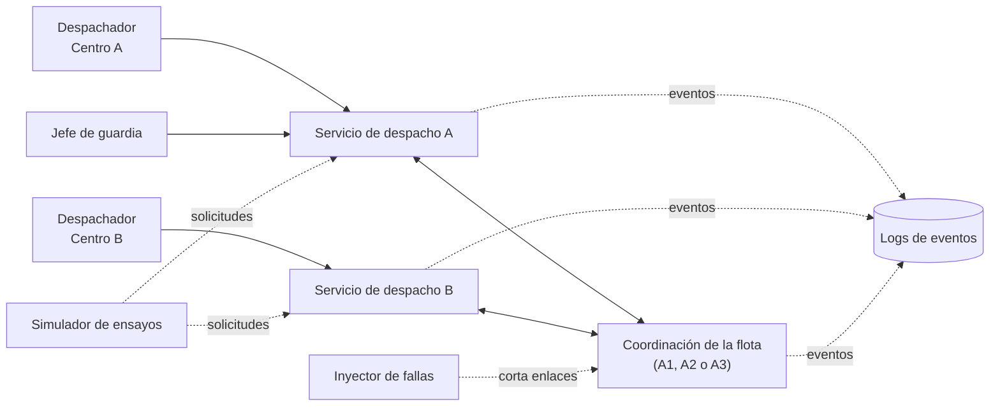
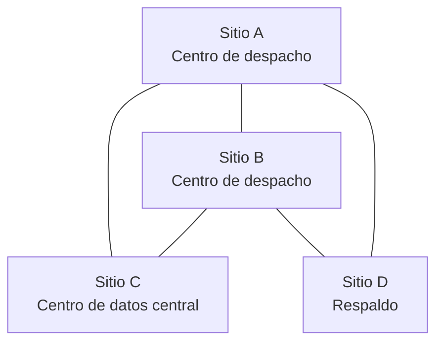
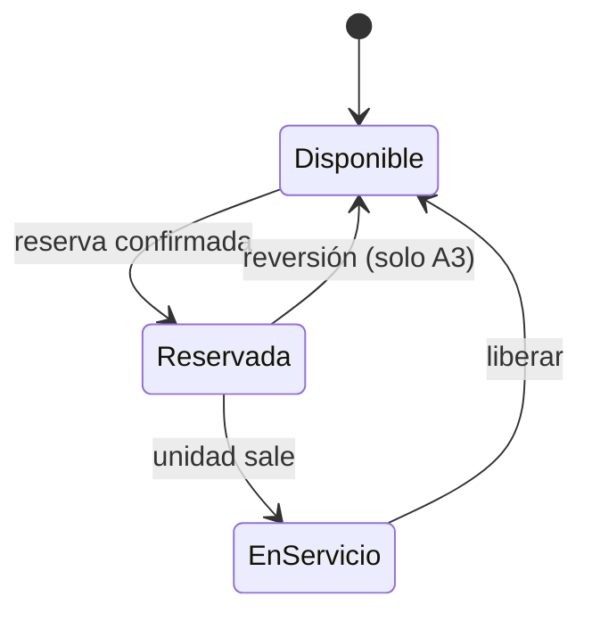
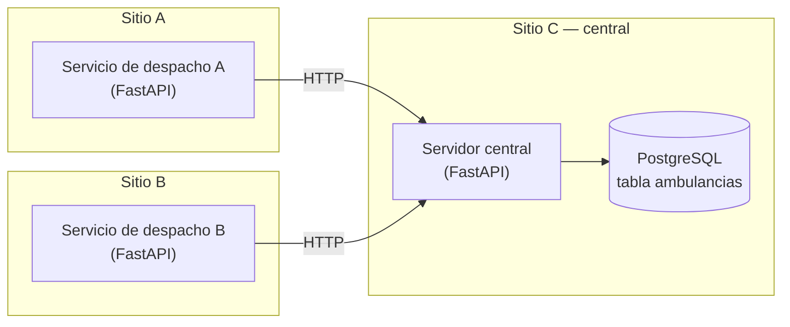
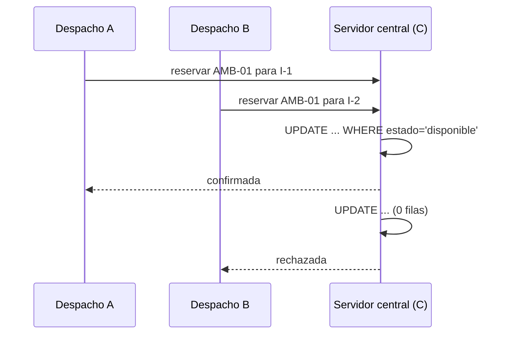
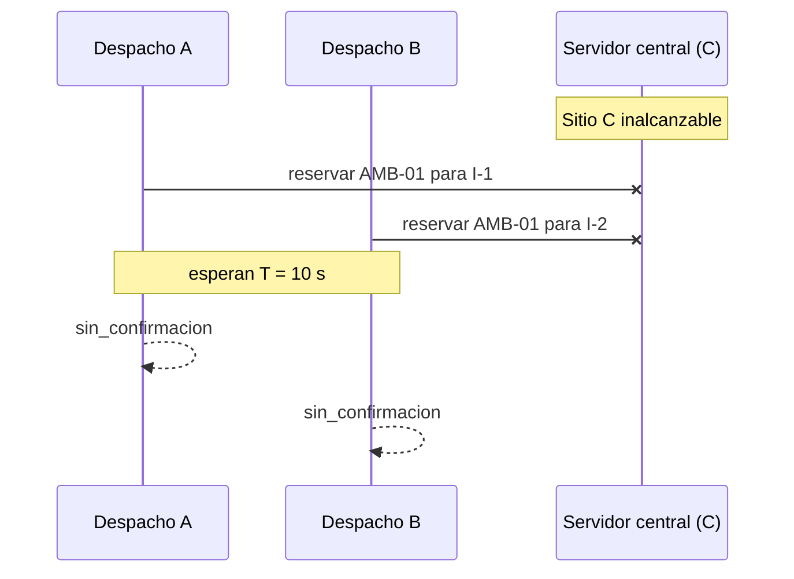

# Arquitectura base

La arquitectura base representa el modelo predominante hoy: **un servidor central con una base de datos** que confirma cada reserva. Es la línea base contra la que se mide la mejora (A2, ver [ArquitecturaMejorada.md](ArquitecturaMejorada.md)).

Este documento también define los elementos **comunes a las tres alternativas**: topología, interfaz, modelo de datos y regla de consistencia. Así, las tres se comparan bajo las mismas condiciones.

---

## Contexto del sistema (común a A1, A2 y A3)



- El **despachador** recibe el incidente ya regulado (prioridad I–II) y solicita una ambulancia.
- El **servicio de despacho** de cada centro expone la misma interfaz en las tres alternativas.
- La **coordinación de la flota** es lo único que cambia entre A1, A2 y A3.
- El **simulador** y el **inyector de fallas** son parte del entorno experimental, no del sistema.

## Topología de sitios (común)

Se simulan cuatro sitios conectados por red. Cada enlace puede cortarse por separado.

| Sitio | Rol | Qué hay en A1 | Qué hay en A2 | Qué hay en A3 |
|---|---|---|---|---|
| **A** | Centro de despacho A | Servicio de despacho | Servicio + réplica etcd 1 | Servicio + base local |
| **B** | Centro de despacho B | Servicio de despacho | Servicio + réplica etcd 2 | Servicio + base local |
| **C** | Centro de datos central | **Servidor central + PostgreSQL** | — | — |
| **D** | Sitio de respaldo | — | Réplica etcd 3 | — |



Entre sitios se agrega una **latencia base de 20 ms por sentido** (con `tc netem` en las interfaces de las redes de enlace), para no medir una red irreal de 0 ms dentro de una misma máquina. El RTT entre dos sitios conectados es, por lo tanto, de unos 40 ms.

### Redes del banco de pruebas (común)

| Tipo de red | Nombre | Qué contiene | ¿Se corta? | Latencia |
|---|---|---|---|---|
| **Enlace** entre sitios | `<arq>_net_ab`, `_ac`, `_ad`, `_bc`, `_bd` | Solo los contenedores de esos dos sitios | Sí (inyector de fallas) | 20 ms por sentido |
| **Local de sitio** | `<arq>_net_site_a`, `_site_b`, `_site_c` | Los contenedores de un mismo sitio (p. ej. `central-api` ↔ `postgres`, `despacho-a` ↔ `etcd1`) | Nunca | Ninguna |
| **Control** | `net_ctl` | El orquestador y los servicios del sistema | Nunca | Ninguna |

- **IPs fijas:** toda la coordinación entre sitios usa IPs fijas de las redes de enlace (plan `10.<arq>.<enlace>.0/24`), nunca nombres de contenedor. Al restaurar un enlace, el contenedor se reconecta con **la misma IP** (`docker network connect --ip`).
- **Redes internas:** todas las redes son `internal` de Docker, así que los contenedores no tienen ruta por defecto. Un paquete hacia un sitio cuyo enlace está cortado no puede salir por otra red.
- **Aislamiento de `net_ctl`:** el orquestador tiene la IP fija `10.99.0.2`. Cada contenedor del sistema, al arrancar, configura `iptables` para aceptar tráfico de `net_ctl` **solo desde el orquestador**. Así ningún servicio puede coordinarse con otro a través de la red de control.
- **PostgreSQL** (A1) vive solo en la red local del sitio C: no está en `net_ctl`. El orquestador lee el estado real a través de `central-api`.
- Esto se verifica automáticamente (`experimento/verificar_fallas.py`): con todos los enlaces cortados (P3), ningún contenedor alcanza a otro sitio por ninguna red, y ninguno alcanza a otro por `net_ctl`.

## Interfaz común

Los servicios de despacho de A1, A2 y A3 exponen la misma API (REST):

| Operación | Entrada | Salida |
|---|---|---|
| `POST /reservas` | `incidente`, `ambulancia`, `prioridad`, `ensayo` | `estado`: **confirmada** · **rechazada** · **sin_confirmacion**; `t_respuesta` |
| `POST /liberar` | `ambulancia` | `ok` |
| `GET /ambulancias` | — | Estado de cada unidad según el centro que consulta |

El centro que solicita queda implícito en el servicio que recibe la solicitud (cada centro tiene el suyo).

**Margen de respuesta:** el servicio deja de intentar coordinar **200 ms antes de T** (a los 9,8 s) y entonces responde `sin_confirmacion`. Se midió que, entre que el manejador termina y la respuesta llega al despachador, pasan 10–50 ms dentro del propio servicio (uvicorn); con un margen de 50 ms, el despachador llegaba a recibir la respuesta a los 10,02 s, después de T. Con 200 ms la recibe a ≈ 9,85 s.

**Regla de respuesta (RF-03):** toda solicitud recibe una respuesta en un máximo de **T = 10 s**. Si el servicio no logra coordinar antes de T (incluidos los errores de conexión, que se reintentan cada 200 ms hasta agotar T), responde **sin_confirmacion**. Ninguna solicitud queda esperando indefinidamente.

**Operaciones de administración** (solo las usan el orquestador y el monitor, por `net_ctl`):

| Operación | Entrada | Salida |
|---|---|---|
| `POST /admin/reset` | `ambulancias`, `contexto` (`arq`, `escenario`, `ensayo`, `tipo`) | Deja las unidades disponibles, fija el contexto del ensayo y vacía los eventos del servicio |
| `GET /admin/health` | — | `ok`, `id_arranque` (cambia si el contenedor se reinicia), `uptime` |
| `GET /admin/eventos` | — | Eventos propios del servicio en el ensayo (p. ej. `liberada`, `revertida`) |
| `GET /admin/pendientes` (solo A3) | — | Eventos que faltan por sincronizar |

## Modelo de datos (común)



| Entidad | Campos |
|---|---|
| **Ambulancia** | `id`, `estado`, `incidente_asignado`, `version` |
| **Incidente** | `id`, `prioridad`, `centro`, `t_solicitud` |
| **Evento** (log) | `t` (`time.time()`), `ensayo`, `arq`, `escenario`, `tipo`, `centro`, `incidente`, `ambulancia`, `evento`, `extra` (datos adicionales: `nodo`, `lider`, `t_solicitud`, `t_respuesta`…) |

**Quién escribe los logs:** solo el orquestador escribe archivos. Los servicios guardan sus eventos propios en memoria y el orquestador los recoge con `GET /admin/eventos` al final de cada ensayo, conservando su `t` original. Así ningún archivo tiene dos procesos escribiendo a la vez a través del volumen compartido.

**Invariante de consistencia (RNF-01):** en todo instante, una ambulancia tiene **como máximo una reserva confirmada**. Una confirmación comunicada al despachador y revertida después cuenta como violación.

## Diseño de A1



**Cómo se confirma una reserva:** el servidor central ejecuta una actualización atómica condicionada:

```sql
UPDATE ambulancias
SET estado = 'reservada', incidente_asignado = :incidente, version = version + 1
WHERE id = :ambulancia AND estado = 'disponible'
RETURNING id;
```

- 1 fila actualizada → **confirmada**.
- 0 filas → **rechazada** (la unidad ya no está disponible).
- Sin respuesta del servidor en T = 10 s → **sin_confirmacion**.

**Reserva idempotente:** si el `UPDATE` devuelve 0 filas pero la unidad ya está reservada **para el mismo incidente**, la respuesta es **confirmada**. Esto cubre el caso de un reintento cuya primera respuesta se perdió: sin esta regla, el reintento encontraría la unidad ocupada y respondería `rechazada` por error. El `UPDATE` no cambia; solo se agrega una consulta cuando devuelve 0 filas.

Como la base es única y la operación es atómica, **A1 es linealizable**: nunca produce doble asignación mientras exista el servidor.

## Secuencias

**Operación normal: dos solicitudes por la última ambulancia**



**Escenario P1: el sitio C no es alcanzable y el enlace A–B se corta**



## Comportamiento esperado de A1 ante cada escenario

| Escenario | Qué se corta | Resultado esperado |
|---|---|---|
| **P1** | Sitio C inalcanzable + enlace A–B cortado; A–D sigue | Ningún centro confirma: **0 % doble asignación, 0 % despacho válido** |
| **P2** | Solo B aislado de todos | A confirma y B no: el despacho sigue para A |
| **P3** | Todos los enlaces cortados | Ningún centro confirma |
| **P4** | Enlace B–C intermitente | Confirma cuando el enlace está arriba; riesgo de respuestas tardías |

**Punto único de falla:** el sitio C. Si cae o queda aislado, **todo el despacho se detiene**, aunque los centros A y B estén operativos. Esto es lo que la arquitectura mejorada busca resolver.

## Limitaciones conocidas de la base

- **SPOF en C:** no hay redundancia del servidor ni de la base.
- **Variante del mercado no modelada:** los CAD comerciales agregan un respaldo activo-pasivo que se activa en minutos. Se deja fuera porque su tiempo de activación supera el plazo T = 10 s del experimento. Se menciona como amenaza a la validez en el paper.
- **Sin operación degradada:** un centro aislado no puede hacer nada más que esperar o coordinar por radio.

## Tecnologías de A1

| Componente | Tecnología | Motivo |
|---|---|---|
| Servicio de despacho y servidor central | Python + FastAPI | El mismo lenguaje que el simulador; API simple |
| Base de datos | PostgreSQL 16 | Actualización atómica condicionada; estándar en CAD tradicionales |
| Contenedores y red | Docker Compose | Uno o más contenedores por sitio; una red por enlace, una red local por sitio y la red de control |
| Latencia y cortes | `tc netem` + `docker network disconnect` / `connect --ip` | Latencia base controlada y cortes reproducibles, sin cambiar las IPs |