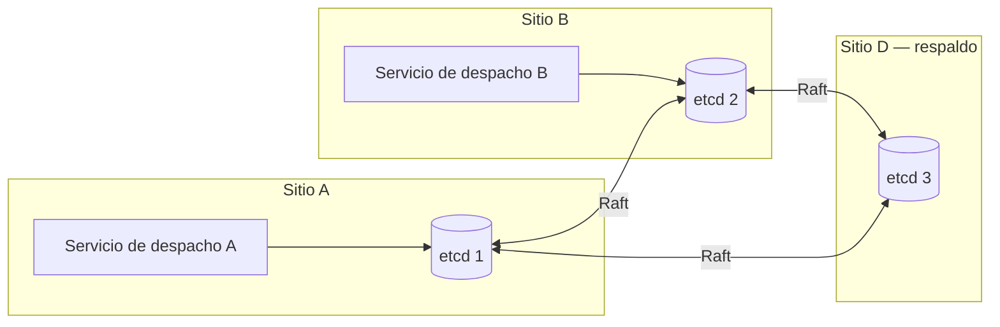
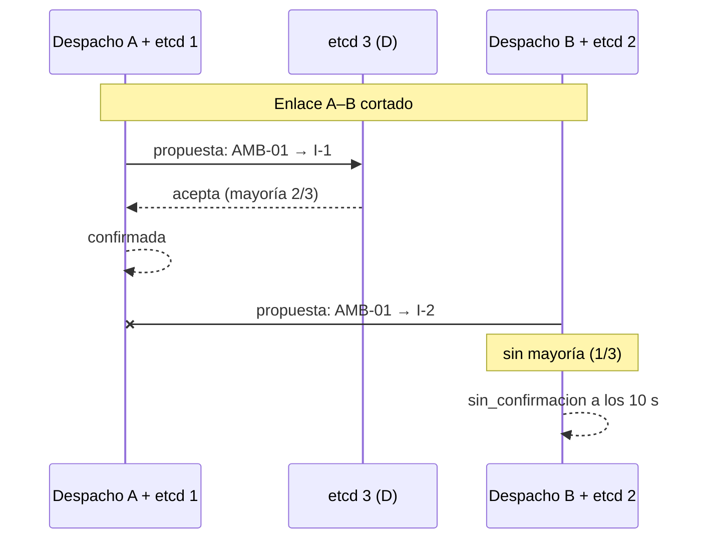
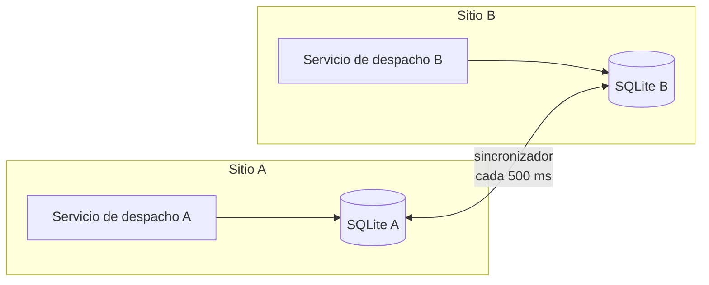
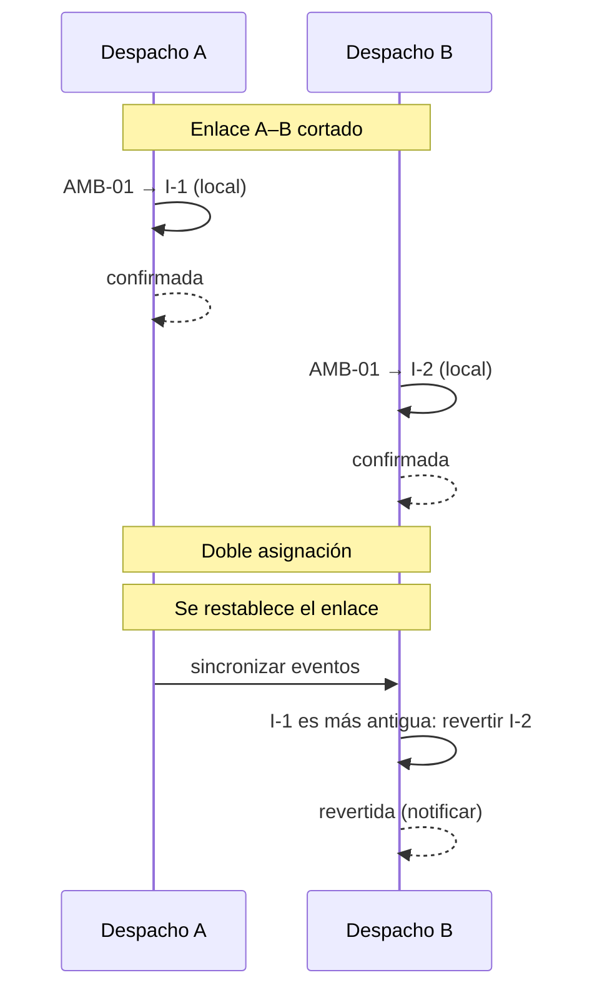

# Arquitectura mejorada

La arquitectura mejorada **elimina el punto único de falla de A1 sin aceptar dobles asignaciones**. El estado de la flota se replica en tres sitios y una reserva se confirma solo si la acepta la **mayoría** de las réplicas, mediante el consenso Raft.

Como contraste se diseña **A3 (local con reconciliación)**, que prioriza seguir despachando. Con las tres alternativas, el experimento cubre las dos opciones del teorema CAP. La topología, la interfaz, el modelo de datos y el invariante son los mismos de [ArquitecturaBase.md](ArquitecturaBase.md).

---

## Qué se mejora respecto de A1

| Problema de A1 | Cómo lo resuelve A2 |
|---|---|
| El sitio C es un punto único de falla | El estado vive en 3 réplicas (A, B, D); cualquier mayoría (2 de 3) sigue operando |
| Si C cae, ningún centro despacha | El centro que conserva la mayoría sigue confirmando |
| El respaldo comercial tarda minutos en activarse | Raft elige un nuevo líder en alrededor de 1–2 s (timeout de elección de etcd por defecto: 1000 ms) |
| — | **Se mantiene** la garantía de A1: una sola reserva confirmada (linealizable) |

**Lo que A2 no resuelve:** el centro que queda en el **lado minoritario** no puede confirmar. Esto se mide explícitamente y no se oculta.

## Diseño de A2



- **etcd** implementa Raft: un líder ordena las escrituras y las replica; una escritura se confirma cuando la persiste la mayoría.
- Cada servicio de despacho se conecta al clúster **solo por medio de su réplica local** (`despacho-a` → `etcd1`, `despacho-b` → `etcd2`), por la red local de su sitio (`net_site_a`, `net_site_b`). Las lecturas y escrituras son **linealizables** (opción por defecto de etcd).
- Los peers de Raft se comunican por las redes de enlace, con IPs fijas: etcd1–etcd2 por `net_ab`, etcd1–etcd3 por `net_ad`, etcd2–etcd3 por `net_bd`. Cada miembro anuncia sus dos IPs de enlace como peer URLs; cada peer solo logra conectarse por la red que comparte con él.
- **Configuración de Raft:** timeouts por defecto de etcd (heartbeat 100 ms, elección 1000 ms) y **`--pre-vote=true` activado explícitamente** en los tres nodos. Con *pre-vote*, un nodo que estuvo aislado (p. ej. etcd2 al volver del lado minoritario) primero pregunta si ganaría una elección antes de subir su término. Así no obliga al líder sano a dejar el cargo, ni provoca una elección innecesaria al reconectarse.
- **Imagen propia de etcd:** la oficial no trae `tc`. Se usa Debian slim (`python:3.12-slim`, que ya trae los certificados para instalar paquetes por HTTPS) más los binarios oficiales de etcd v3.5.36, `iproute2`, `iptables` y `ping`.
- El sitio C (central) no se usa en A2. Por eso, el escenario P1 (C inalcanzable) no afecta a esta arquitectura.

**Cómo se confirma una reserva:** con una transacción condicional (compare-and-swap) de etcd, usando su API JSON (`POST /v3/kv/txn`).

```python
ok, actual = txn(
    compare=value(f"/amb/{amb}") == "disponible",
    success=put(f"/amb/{amb}", f"reservada:{incidente}"),
    failure=get(f"/amb/{amb}"),
)
# ok=True                                → confirmada
# ok=False y actual == reservada:<mismo>  → confirmada (reserva idempotente)
# ok=False                               → rechazada
# sin respuesta de la mayoría en T = 10 s → sin_confirmacion
```

**Reserva idempotente:** igual que en A1, si la comparación falla pero el valor ya es `reservada:<mismo incidente>` (un reintento cuya primera respuesta se perdió), la respuesta es **confirmada**.

**Reserva sin aviso:** como una escritura puede completarse después de T, al final de cada ensayo el orquestador lee el valor final. Si la unidad quedó reservada para un incidente cuyo cliente no recibió `confirmada`, registra `reserva_sin_aviso`. Esta revisión se hace en las tres arquitecturas, no solo en A2.

## Secuencias de A2

**Escenario P1: C inalcanzable y enlace A–B cortado; A conserva a D**



**Si el líder estaba en B al iniciar el corte:** A y D no reciben latidos del líder, eligen uno nuevo entre ellos (alrededor de 1–2 s) y luego confirman. Por eso, en P1 se prueban ambos casos: antes del corte, el orquestador mueve el líder con `etcdctl move-leader` a **etcd1 ("lado de A", mayoritario)** o a **etcd2 ("lado de B", minoritario)**, en la mitad de los ensayos cada uno. Además, en `extra.lider` se registra qué nodo era el líder real al iniciar el corte, aunque sea etcd3.

**Cómo se mueve el líder:** `move-leader` solo lo acepta el líder actual. En la preparación, el orquestador consulta quién es el líder (`endpoint status` en los tres miembros), le envía la transferencia hacia el destino y **verifica que los tres miembros reportan al nuevo líder** antes de seguir. Si no se aplica, reintenta; si tras los reintentos sigue sin aplicarse, el ensayo cuenta como inválido. El orquestador usa la API JSON de etcd por `net_ctl`, que expone los mismos RPC que `etcdctl` (`/v3/maintenance/status`, `/v3/maintenance/transfer-leadership`).

**Elección durante el ensayo:** con el líder del lado de B, la nueva elección (1–2 s) puede coincidir con las solicitudes de t = 3 s. Por eso, durante el corte el orquestador consulta cada 50 ms a etcd1 y etcd3, y registra en `extra` el momento en que detecta al líder del lado mayoritario (`t_lider_mayoria`, `lider_mayoria`). Con ese dato se puede explicar M3 en los resultados. En la verificación de la F3, la mayoría tuvo líder a los 1,23 s del corte, y al matar al líder el nuevo se detectó en 1,2–1,5 s.

**Hallazgos del piloto (F5):**

- **Recuperación lenta del nodo que estuvo aislado (M5 ≈ 12–13 s en P1, P2 y P3). Causa confirmada: el retroceso exponencial de retransmisión de TCP en los streams de Raft que sobreviven al corte.**
  - **Síntoma:** al restaurar la red, etcd2 ya conoce al líder y tiene la misma revisión, y sus lecturas *serializables* responden al instante. Pero durante unos 12 s sus escrituras y lecturas *linealizables* fallan por timeout (el log de etcd muestra *"timed out waiting for read index response"* y luego *"read indexes queueing up and waiting to be in sync with leader"*).
  - **Mecanismo** (`experimento/investigar_a2.py`, con `ss -tino` en etcd2 cada 0,5 s y los logs de etcd con nivel `info`):
    - Las conexiones TCP de los streams de Raft **no se cierran** durante el corte: no aparece ningún *"lost TCP streaming connection"*.
    - Tras 20 s sin respuesta, el stream de etcd2 hacia el líder llega a `backoff=6` y `rto=15616 ms`. Su cola de envío crece de 1 KB a 23 KB sin salir.
    - Al restaurar, el temporizador de reenvío todavía tiene unos 12 s pendientes. El kernel no reintenta antes aunque la red ya funcione.
    - A los +12,0 s vence el temporizador, la cola se vacía de golpe (23 047 → 61 bytes) y el RTO vuelve a 244 ms. En el mismo instante (+12,3–12,5 s), etcd2 vuelve a recibir respuestas de ReadIndex y el monitor detecta el estado consistente.
  - **No depende del método de corte:**

    | Método de corte | M5 en A2-P1 (líder en etcd1) |
    |---|---|
    | `docker network disconnect` / `connect` (el del experimento) | 12,43 s y 12,58 s |
    | `iptables -j DROP` en ambos extremos (la interfaz no desaparece) | 13,66 s, 12,83 s y 13,55 s |

    Con ambos métodos se observa el mismo `backoff=6` / `rto=15616 ms` y la misma descarga de la cola a los ~12 s. Una partición real (pérdida silenciosa de paquetes) produce el mismo efecto, así que se reporta como un **costo real de A2** con los parámetros TCP por defecto de Linux, no como un artefacto del banco de pruebas. Un despliegue real podría reducirlo con *keepalives* o timeouts de usuario de TCP más cortos, o con la detección de streams inactivos de etcd; eso queda fuera del alcance.
  - En **P4** se esperaba que no apareciera, porque el enlace está arriba en la última ventana (19–21 s) y el backoff no debería crecer tanto. **La F7 lo desmiente en parte** (19-11-2026): en 4 de 20 ensayos de A2-P4 M5 fue 12,27–12,44 s (sin conflicto rep 2 y 3; con conflicto rep 11 y 15), en uno 4,22 s (con conflicto rep 0) y en el resto 0,3–0,4 s (M5 p50 = 0,295 s, p95 = 12,44 s). Los valores de ~12,4 s coinciden con el del retroceso TCP de P1–P3, así que lo más probable es el mismo mecanismo (algún stream de Raft quedó en backoff pese a las ventanas arriba). **No se confirmó con capturas de `ss` en esos ensayos.**
  - **El estado consistente no garantiza que las lecturas linealizables ya funcionen** (observado en la F7, 19-11-2026, en un ensayo A2-P3): el monitor vio a ambos centros con el mismo estado y a las 3 réplicas con la misma revisión, y justo después una lectura en la réplica de A devolvió 503 por timeout de ReadIndex; el líder (etcd2) registró *"leader failed to send out heartbeat on time"*. Duró alrededor de 1–2 s. M5 se mide con la definición de `Metricas.md` (mismo estado y misma revisión), así que esta inestabilidad posterior no entra en M5; el orquestador reintenta esa lectura (ver criterios de invalidez en `DiseñoExperimento.md`).
- **Reserva sin aviso en P3.** Si el líder está del lado de A y la solicitud de A llega antes de que el líder renuncie por falta de quórum (*check-quorum*, hasta un timeout de elección después del corte), el líder añade la entrada a su log aunque no pueda confirmarla. A recibe `sin_confirmacion` a los 10 s, y al restaurarse la red la entrada se replica y se confirma: la unidad queda reservada sin que nadie lo sepa. Ocurrió en 1 de 3 ensayos del piloto. El orquestador lo detecta y registra `reserva_sin_aviso`.
  - En la **F7** ocurrió en 1 de 20 ensayos de A2-P3: con conflicto, rep 4 (`A2/P3/ensayo_4`). El líder era etcd1, el corte empezó en t = 1,02 s y A pidió en t = 3,00 s, o sea **1,98 s después del corte**, más que el timeout de elección (1 s). Es compatible con que *check-quorum* de etcd revise la actividad de los seguidores una vez por timeout de elección, de modo que el líder puede tardar hasta ~2 timeouts en renunciar. Esto no se confirmó con los logs de etcd. A y B recibieron `sin_confirmacion`; el estado final quedó con la reserva de A (I-1).
- **Reserva sin aviso en P4 (F7, 19-11-2026).** Hubo 1 caso en 20 ensayos de A2-P4: sin conflicto, rep 3 (`A2/P4/ensayo_103`).
  - El líder era etcd1, del lado de A, y solo pidió B, que en P4 queda en minoría mientras el enlace está cortado.
  - B pidió en t = 3,00 s, justo al abrirse una ventana con el enlace arriba, y recibió `sin_confirmacion` a los 9,82 s.
  - Al restaurar la red, el estado quedó con AMB-01 reservada para I-1, el incidente de B.
  - El mecanismo es el mismo que en P3: la entrada llegó al líder y se confirmó después de T.
  - Ese ensayo es uno de los 4 de A2-P4 con M5 ≈ 12,4 s. Lo probable es que el stream de Raft de etcd2 estuviera en retroceso TCP y que B no se enterara de la confirmación dentro de T, aunque el enlace estuvo arriba en las ventanas de P4. No se confirmó con capturas.
  - El otro `sin_confirmacion` de A2-P4 (con conflicto, rep 15: B pidió primero y A confirmó) también está entre esos 4 ensayos lentos. En ese caso no hubo reserva sin aviso: el estado final quedó con el incidente de A.
  - Ninguna corrección: es un costo real de A2 y la detección funciona.

## Comportamiento esperado de A2

| Escenario | Resultado esperado |
|---|---|
| **P1** | A confirma (mayoría A + D); B responde sin_confirmacion. **0 % doble asignación, despacho válido alto** |
| **P2** | A confirma; B (aislado) no puede |
| **P3** | Nadie tiene mayoría: nadie confirma (igual que A1) |
| **P4** | Confirma cuando hay mayoría; durante los cambios de líder puede haber respuestas más lentas |
| **Sin falla** | Mayor latencia que A1: cada escritura espera la réplica de la mayoría (H4) |

---

## Alternativa de contraste: A3 (local con reconciliación)

A3 representa el enfoque *offline-first*: cada centro tiene su propia copia de la flota y **confirma localmente sin esperar a nadie**.



- **Reserva:** la misma actualización condicionada de A1, pero sobre la base **local**. Siempre responde en milisegundos.
- **Eventos:** cada reserva confirmada y cada liberación local generan un evento (`reserva` o `liberada`) con id único, centro de origen, ambulancia, incidente y `t`. **`liberada` se propaga igual que las reservas.**
- **Sincronización:** el sincronizador va **dentro del propio servicio de despacho** (no hay contenedores aparte). Cada 500 ms envía al otro centro, por `net_ab`, los eventos propios que el otro lado aún no confirmó haber recibido. El receptor los guarda (de forma idempotente, por id) y responde con los ids recibidos. `GET /admin/pendientes` informa cuántos eventos propios faltan por confirmar (lo usa el monitor). Cada ensayo tiene una *época* (fijada por `/admin/reset`), y los eventos de otra época se descartan.
- **Regla de reconciliación (RF-09), determinista y simétrica:** cada centro calcula el estado con la **misma función pura** sobre el conjunto de eventos que conoce. Ordena los eventos por (`t`, centro), con A antes que B en empate, y los aplica en orden:
  - una `reserva` sobre una unidad disponible la asigna;
  - una `reserva` sobre una unidad ya asignada **pierde**, porque gana la más antigua;
  - una `liberada` libera la unidad solo si está asignada a ese mismo incidente.

  Con el mismo conjunto de eventos, ambos centros llegan exactamente al mismo estado, sin coordinador. Hay pruebas unitarias que comprueban que el resultado no depende del orden de llegada.
- **Reversión:** la registra **el centro cuya confirmación se revierte** (evento `revertida`), con el incidente afectado y, en `extra`, el incidente y el centro ganadores y los timestamps de ambas reservas. El otro centro no registra nada. En un despliegue real, aquí se notificaría al despachador y al jefe de guardia.
- **Momento de la reconciliación:** el `t` del evento `revertida` es el instante exacto en que el centro aplicó la regla. En P4 puede caer dentro de la ventana del corte, en un intervalo con el enlace arriba. En la verificación de la F4 ocurrió a los 2,5–2,8 s del corte, durante la primera ventana arriba.



**Comportamiento esperado:** en P1, P3 y P4, ambos centros confirman de inmediato, lo que da **doble asignación en casi todos los ensayos con conflicto**. En los ensayos **sin conflicto**, A3 es la única que confirma siempre a tiempo.

**Hallazgo: A3 asigna dos veces incluso sin falla.** Con la red sana, si la segunda solicitud llega antes de que el evento del otro centro se haya sincronizado, el segundo centro todavía ve la unidad disponible y confirma. Esto pasa cuando δ es menor que el retardo de sincronización: hasta 500 ms del ciclo del sincronizador, más 20 ms de latencia de un sentido. Luego la reconciliación revierte una de las dos, pero el despachador ya actuó.

En la verificación de la F4 (40 ensayos con la red sana y δ ∈ [0, 200] ms):

| Sincronizador | Ensayos con 1 confirmada + 1 rechazada | Ensayos con doble asignación |
|---|---|---|
| Cada 500 ms (el diseño elegido) | 3/40 | 37/40 |
| Envío inmediato + reintento cada 500 ms (variante no usada) | 33/40 | 7/40, exactamente los de δ ≤ 22 ms |

Ni siquiera el envío inmediato elimina el problema: ninguna arquitectura AP puede rechazar una solicitud cuyo conflicto todavía no le llegó. Se mantiene el ciclo de 500 ms de la especificación. Para medir este costo sin falla, la corrida principal incluye el escenario **P0 con conflicto** como línea base.

> Nota: en un despliegue real, comparar timestamps de máquinas distintas requiere relojes híbridos (HLC). En el experimento todos los contenedores comparten el reloj del host, así que se simplifica.

---

## Comparación de las tres arquitecturas

| | A1 Centralizado (base) | **A2 Quórum (mejorada)** | A3 Local (contraste) |
|---|---|---|---|
| Dónde vive el estado | 1 base en C | 3 réplicas (A, B, D) | 1 copia por centro |
| Quién confirma | El servidor central | La mayoría de réplicas | Cada centro, solo |
| Garantía | Linealizable | Linealizable | Consistencia eventual |
| Punto único de falla | Sí (C) | No, mientras haya mayoría | No |
| Lado CAP ante partición | CP | CP | AP |
| Resultado esperado en P1 | Nadie confirma | Confirma el lado mayoritario | Ambos confirman (conflicto) |
| Costo sin falla | 1 viaje al servidor | Viaje al líder + réplica a la mayoría | Local (mínimo) |

## Decisiones de arquitectura (ADR)

**ADR-01. Usar etcd en lugar de implementar Raft.**
Implementar consenso a mano consume el tiempo del proyecto y es propenso a errores. etcd es una implementación de Raft probada en producción (por ejemplo, en Kubernetes) y ofrece transacciones condicionales linealizables.

**ADR-02. Tres réplicas en tres sitios distintos (A, B, D).**
Tres es el mínimo que tolera la caída de un sitio. La tercera réplica va en un sitio de respaldo (D), no en el centro de datos central (C), para que la caída de C no afecte a A2. Cinco réplicas quedan para la arquitectura escalada del E3.

**ADR-03. A3 con regla "gana la confirmación más antigua".**
Es la regla más simple y determinista. Permite medir el costo de la reconciliación sin introducir lógica de prioridad clínica, que está fuera del alcance.

**ADR-04. Interfaz única para las tres alternativas.**
El simulador no sabe contra qué arquitectura corre, lo que garantiza que las tres reciban exactamente las mismas solicitudes (RNF-08).

**ADR-05. Timeout de respuesta T = 10 s en todas las alternativas.**
Es el plazo común para responder sin_confirmacion. La justificación está en [Metricas.md](Metricas.md).

## Tecnologías

| Componente | A1 | A2 | A3 |
|---|---|---|---|
| Servicio de despacho | Python + FastAPI | Python + FastAPI | Python + FastAPI |
| Almacenamiento | PostgreSQL 16 | etcd 3.5 (3 nodos) | SQLite por centro |
| Coordinación | Transacción SQL atómica | Raft (transacción etcd) | Sincronizador propio (Python) |
| Común | Docker Compose, `tc netem`, simulador en Python, logs JSONL |

## Hacia la arquitectura escalada (E3)

- **5 réplicas** de etcd, para tolerar dos sitios caídos.
- **Más de dos centros** (por ejemplo, SAMU, bomberos y un centro 911).
- **Flota completa** (19 a 33 unidades) con varios incidentes concurrentes, no solo la última ambulancia.
- **Variante con propiedad de unidades por centro (escrow):** cada centro confirma sin coordinación sus propias unidades y usa el quórum solo para las prestadas.